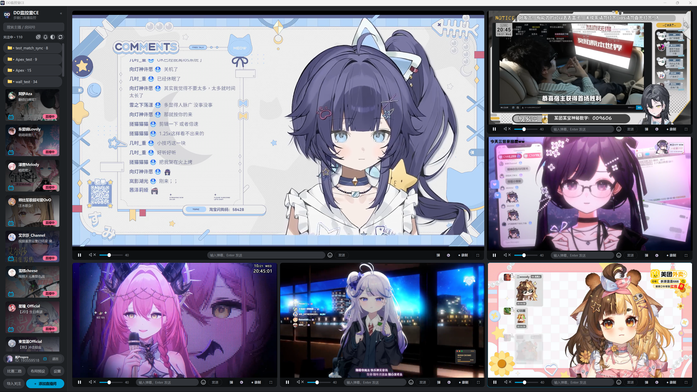
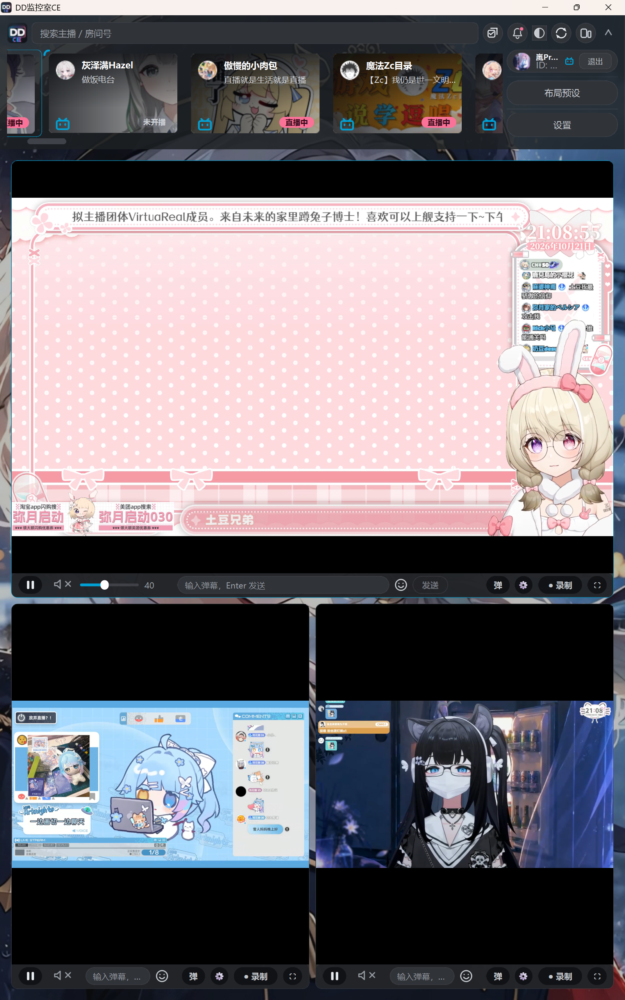
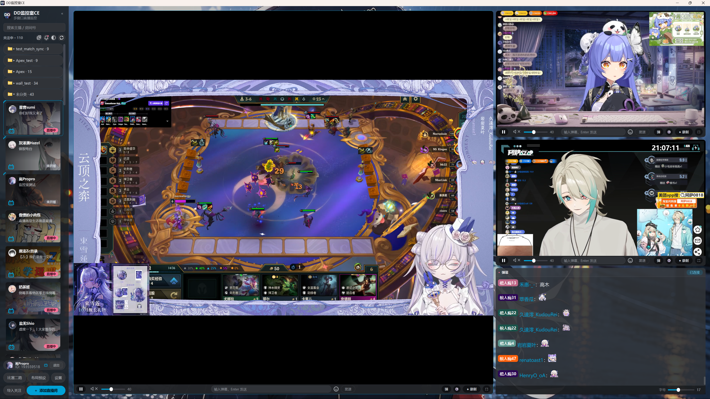

  

<h1 align="center">DD监控室CE</h1>

<h3 align="center">把喜欢的直播，摆成你的样子</h3>

DD监控室CE 是一款免费、开源的 Windows 多路直播观看工具。把常看的直播间放进同一面画面墙，每一路的画质、音量和弹幕都能单独调节。

  <a href="#下载">下载软件</a> · <a href="#快速开始">快速开始</a> · <a href="#插件扩展">插件扩展</a> · <a href="#使用帮助与反馈">反馈问题</a>

查看竖屏布局和弹幕布局

## 下载

当前已发布版本 **1.0**，支持 **Windows 10 / 11 64 位**。

- **安装版**：下载并运行安装程序。[下载 1.0 安装版](https://github.com/Lanpropro/DD_Monitor_CE/releases/download/v1.0/DDMonitorSetup.exe)
- **便携版**：完整解压 ZIP 后运行 `DD监控室CE.exe`。[下载 1.0 便携版 ZIP](https://github.com/Lanpropro/DD_Monitor_CE/releases/download/v1.0/DDMonitorCE-v1.0-exe.zip)
- **已有用户**：打开「设置 → 软件更新」检查新版。

[查看 1.0 更新说明](docs/releases/RELEASE-v1.0.md) · [查看所有版本](https://github.com/Lanpropro/DD_Monitor_CE/releases)

## 快速开始

1. 点击「添加直播间」，输入 B 站直播间链接或房间号。
2. 点击画面墙上空白播放格里的「＋」。
3. 在关注列表中选中刚添加的直播间，即可开始播放。

- **导入关注**：点击「导入关注」，从已登录的 B 站账号或支持关注导入的平台账号中选择主播。
- **调整布局**：从「布局预设」选择横屏或竖屏布局。要保留当前排布，在「布局预设 → 直播间组合」里点击「保存当前组合…」。
- **观看其他平台**：到「设置 → 插件 → 插件商店」安装对应插件。

## 主要功能

- **多路同屏**：画面墙最多放 16 路直播。可单独调节每一路的画质、音量和静音状态。
- **布局与组合**：提供横屏、竖屏和带独立弹幕格的布局。可保存当前直播间和格子排布，下次直接恢复。
- **关注与开播提醒**：可搜索、置顶和分组管理主播。开播提醒和自动录制可以分别设置。
- **弹幕与互动**：弹幕可叠在画面上，也可放到独立弹幕格或浮窗。B 站直播原生支持发送弹幕、表情和礼物互动。
- **录制与即时回放**：可逐路录制，开启即时回放缓存后可在单格回看直播，也可保存最近一段直播。
- **外观与托盘**：可切换深浅主题、更换背景或应用图标。关闭窗口时可选择隐藏到系统托盘，也可直接退出。

## 插件扩展

本体内置 B 站直播支持，也可以按需安装插件扩展其他平台和功能。

| 用途 | 插件示例 |
| --- | --- |
| 国内直播平台 | 虎牙、斗鱼、抖音、企鹅体育 |
| 海外直播平台 | Twitch、YouTube、CHZZK |
| 导入电视频道 | IPTV Play，支持导入 M3U 频道列表 |
| 同时看比赛主路和二路 | 比赛二路同步，支持多路画面对齐 |
| 管理 B 站待看内容 | B 站稍后再看 |

插件独立发布，具体功能、登录要求和兼容版本以插件说明为准。[查看插件仓库](https://github.com/Lanpropro/DD_Monitor_Plugins)

手机端有独立仓库，仍然在开发中。[查看独立移动端项目](https://github.com/Lanpropro/DD_Monitor_Mobile)

## 使用帮助与反馈

提交问题时，请附上软件版本、复现步骤、预期结果和实际结果。有截图也可以一并附上。

如需提供运行记录，可在「设置 → 诊断与反馈」中导出诊断包，检查内容后手动附到 Issue。

[文档中心](docs/README.md) · [提交问题或建议](https://github.com/Lanpropro/DD_Monitor_CE/issues/new/choose) · [开发与贡献](CONTRIBUTING.md)

## 致谢与许可

本项目基于执明神君的 [DD监控室](https://gitee.com/zhimingshenjun/DD_Monitor_latest) 二次开发。感谢 blivedm 提供弹幕协议实现，也感谢 BewlyCat 提供界面设计参考，以及所有参与贡献与测试的朋友。[blivedm](https://github.com/xfgryujk/blivedm) · [BewlyCat](https://github.com/keleus/BewlyCat) · [贡献者名单](https://github.com/Lanpropro/DD_Monitor_CE/graphs/contributors)

DD监控室CE 是个人维护的第三方工具，与哔哩哔哩官方无关。项目采用 GNU LGPL v2.1 许可。[许可证](LICENSE) · [第三方声明](docs/NOTICE.md)
