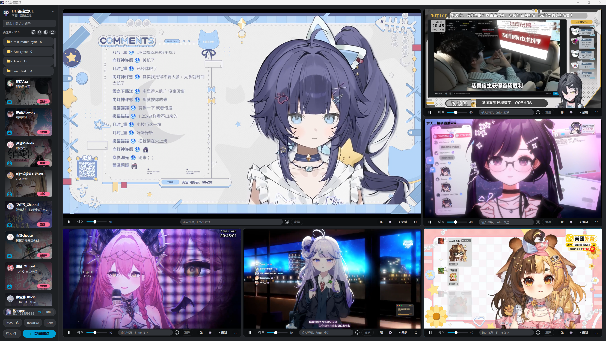
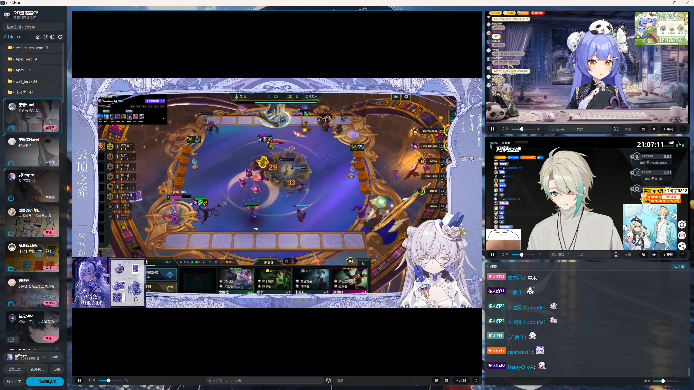
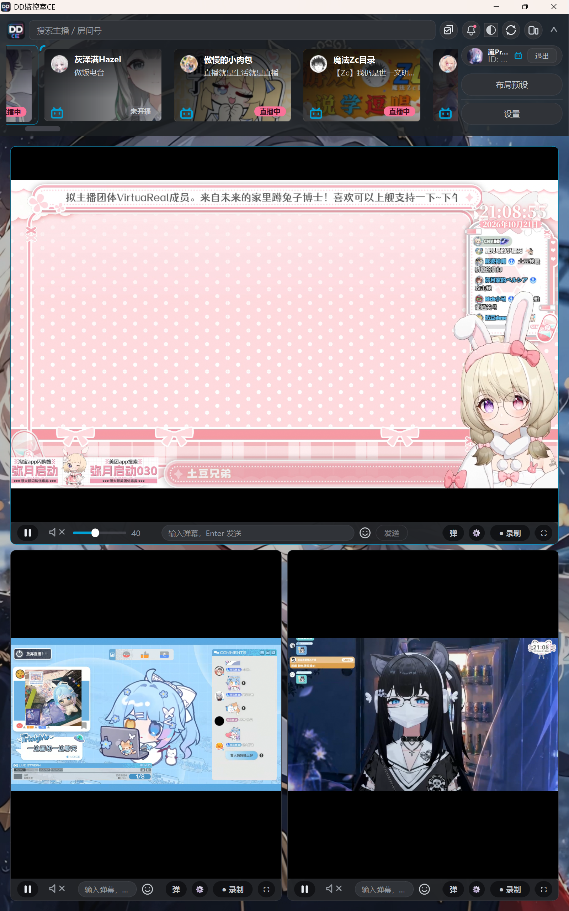

# DD监控室CE

把喜欢的直播，摆成你的样子。

免费、开源的 Windows 多窗口直播观看与监控工具。

[下载软件](https://github.com/Lanpropro/DD_Monitor_CE/releases/latest) · [功能特性](#功能特性) · [插件扩展](#插件扩展) · [文档](#文档) · [反馈问题](https://github.com/Lanpropro/DD_Monitor_CE/issues)

## 一块屏幕，多路直播

将多个直播间集中放进同一面画面墙，自由安排布局，逐路控制画质、声音和弹幕。

本体支持 B 站，通过独立插件接入虎牙、斗鱼、抖音、Twitch 和 YouTube。软件免费使用，无付费解锁功能。

查看弹幕布局与竖屏布局

## 功能特性

| 功能 | 支持内容 |
| --- | --- |
| 多路同屏 | 最多 16 路直播，逐路播放、暂停、关闭和全屏 |
| 布局预设 | 横竖屏预设、跨行跨列布局、方向自动切换，保存与恢复直播间组合 |
| 关注管理 | 账号关注导入、拼音搜索、置顶与拖动排序、普通与智能文件夹、常看优先 |
| 直播监控 | 开播提醒、直播状态刷新、关注悬停预览、断流重连与画面卡死检测 |
| 逐路控制 | 独立画质、音量与静音，左右声道路由，全局与单窗口编解码设置 |
| 弹幕观看 | 独立弹幕格与滚动画面弹幕，字体、字号、颜色显示与屏蔽词过滤 |
| 录制回放 | 每路独立录制、保存最近数分钟的即时回放，原始流直存与显卡重编码 |
| 外观主题 | 深浅主题、自定义图片或静音视频背景、皮肤与美化插件 |
| 软件更新 | 本体与插件独立更新，软件内置更新入口 |
| 后台常驻 | 关闭时选择隐藏到托盘或退出，可记住选择；托盘支持恢复窗口和退出 |

首次关闭窗口时可选择“隐藏到托盘”或“退出程序”。勾选“记住我的选择”后按所选方式关闭；
未勾选则下次继续询问。可在“设置 → 常规 → 关闭窗口时”更改。
隐藏到托盘后继续播放和录制，双击托盘图标恢复窗口；右键菜单可显示/隐藏窗口或退出程序。

## 插件扩展

按需扩展平台与互动功能，插件版本独立于本体。

| 插件 | 功能 |
| --- | --- |
| 国内直播平台 | 接入虎牙、斗鱼、抖音 |
| 海外直播平台 | 接入 Twitch、YouTube |
| 比赛二路同步 | 多路比赛画面对齐、声音与弹幕合并 |
| B 站直播互动 | 弹幕发送、表情选择与礼物互动 |

平台与互动插件不随本体内置，可从软件内的插件商店获取。具体能力及兼容要求以插件说明为准。

[查看插件仓库](https://github.com/Lanpropro/DD_Monitor_Plugins) · [插件说明](docs/plugins.md)

## 下载

当前已发布版本 **0.6**，支持 **Windows 10 / 11 64 位**。

[安装版](https://github.com/Lanpropro/DD_Monitor_CE/releases/download/v0.6/DDMonitorSetup.exe) · [便携版 ZIP](https://github.com/Lanpropro/DD_Monitor_CE/releases/download/v0.6/DDMonitorCE-v0.6-exe.zip) · [全部版本与更新说明](https://github.com/Lanpropro/DD_Monitor_CE/releases)

安装版与便携版均无需安装 Python。官方下载与更新请认准本仓库 Releases。

## 文档

[文档目录](docs/README.md) · [插件说明](docs/plugins.md) · [外观与皮肤](docs/skins.md) · [直播间组合](docs/room-presets-design.md) · [更新机制](docs/online-updates.md) · [开发与贡献](CONTRIBUTING.md)

## 贡献者

感谢所有为 DD监控室CE 贡献代码、修复问题和完善文档的朋友。

欢迎通过 [Issue](https://github.com/Lanpropro/DD_Monitor_CE/issues) 反馈问题，或提交 Pull Request 参与改进。

## 致谢与许可

本项目是 [DD监控室](https://gitee.com/zhimingshenjun/DD_Monitor_latest) 的二次开发版本，原作者为 [执明神君](https://space.bilibili.com/637783)。感谢 [blivedm](https://github.com/xfgryujk/blivedm) 的弹幕协议实现，以及 [BewlyCat](https://github.com/keleus/BewlyCat) 的界面设计参考。

项目采用 [GNU LGPL v2.1](LICENSE) 许可，第三方来源与声明见 [NOTICE](docs/NOTICE.md)。本项目为个人维护的第三方工具，与哔哩哔哩官方无关。
