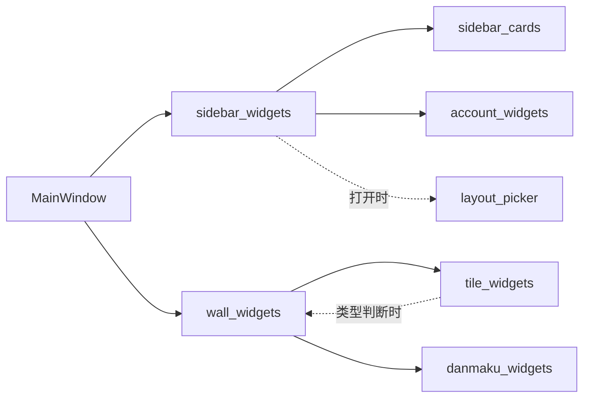

# 共用界面组件

统一调用入口为 `ddm.ui`。先检查这里和下表，再使用 Qt 原生控件或补充真正缺少的组件；颜色、字号、圆角和间距继续由 `ddm.theme` 管理，不在各页面另建配色表。

## 组件目录

| 组件 | 用途 | 原实现/维护位置 |
| --- | --- | --- |
| `ActionButton` | 设置页普通操作按钮，沿用 `IconButton` 样式 | `ddm/ui/basics.py` |
| `TitleLabel`、`HintLabel` | 设置标题、可换行说明，沿用 `SettingsTitle` / `SettingsHint` | `ddm/ui/basics.py` |
| `page_header` | 设置页标题加可选说明 | 从 dialogs 的 `_page_head` 集中提取；旧入口保持别名 |
| `step_button` | 原有 28×28 加减按钮，包含提示和点击回调 | 从 dialogs 的 `_step_button` 集中提取；旧入口保持别名 |
| `Avatar`、`RoomStrip`、`PinnedArc`、`circular_pixmap` | 头像、头像条、置顶标记、圆形图片 | `ddm/avatar_widgets.py` |
| `AnimatedDialog`、`AnimatedMenu` | 已有对话框和菜单的交互/动效 | `ddm/motion.py` |
| `ColorDialog` | 紧凑 RGB / HEX 选色与预览，确认时发出 `colorSelected`，复用现有主题和按钮 | `ddm/ui/color_dialog.py` |
| `SlidingTabs`、`SettingsStack` | 已有页签和设置页面切换 | `ddm/motion.py` |
| `TileButton`、`VolumeButton`、`RecordingButton` | 播放格按钮、音量、录制控件 | `ddm/playback_controls.py` |
| `SidebarToggleButton`、`PauseButton`、`RefreshButton`、`DanmakuToggleButton` | 已有侧栏/播放控制按钮 | `ddm/playback_controls.py` |
| `ElidedLabel`、`BarIconButton` | 省略文字、工具条按钮 | `ddm/ui/labels.py`、`ddm/ui/toolbar.py` |
| `continuous_path` | 矩形表面的连续圆角路径；保留圆形、胶囊及明确的直角 | `ddm/corner_geometry.py` |

原有组件通过统一入口导出同一个类/函数对象，仍在原模块维护，不复制实现。原导入路径继续有效。播放器相关组件保留原有宿主、信号、原生窗口和生命周期要求，不是脱离业务上下文的通用播放框架。

`ddm.ui` 按需加载头像、动效和播放控件；导入基础按钮/标签或上述播放控制按钮不会装载 `widgets`、播放器、主窗口或网页登录模块。播放按钮和音量弹窗集中在 `ddm/playback_controls.py`；`widgets` 保留原类及绘制辅助函数的兼容导出，刷新动画仍归按钮所有，音量弹窗仍归调用方持有。`ElidedLabel`、`BarIconButton` 由 `ddm/ui/labels.py`、`ddm/ui/toolbar.py` 维护，公共入口和旧 `widgets` 导出保持同一对象；导入它们也不会装载播放器或主窗口。使用明确的导入名称，避免 `from ddm.ui import *` 将全部组件一起载入。

## 调用示例

```python
from PySide6.QtWidgets import QWidget, QVBoxLayout
from ddm.ui import ActionButton, HintLabel, page_header

page = QWidget()
layout = QVBoxLayout(page)
layout.addLayout(page_header('图片缓存', '选择需要清理的图片类别'))
status = HintLabel('尚未统计', page)
button = ActionButton('刷新统计', page)
button.clicked.connect(refresh_cache)  # 页面自己的业务函数
layout.addWidget(status)
layout.addWidget(button)
```

调用现有头像或菜单：

```python
from ddm.ui import Avatar, AnimatedMenu

# 使用原构造参数与信号；具体业务状态由页面提供。
# 两个名称分别指向 avatar_widgets.Avatar 与 motion.AnimatedMenu。
```

主题颜色直接读取当前主题，例如 `theme.ACCENT`（主题蓝）、`theme.SUCCESS`（现有绿色）。用 QPainter 绘制 `rgba(...)` 颜色时走 `theme.qcolor()`，不要将 CSS rgba 字符串直接传给 QColor。缓存饼图使用蓝/绿两类，灰色仅用于空状态、辅助文字和边界。

已接入：设置页公共页头和加减按钮、数据与存储页、图片缓存页。以后修改共用样式应修改 `theme.py`；组件行为在实际维护模块修改，并通过统一入口验证兼容性。业务页面如录制管理、账号窗口、缓存管理器仍各自维护，不整体搬入基础组件入口。

## 验证

矩形控件的底色与描边通过 `ddm/continuous_corners.py` 统一绘制，Qt 继续负责原有文字、输入、操作及布局。主题 QSS 仍是颜色、半径、状态和尺寸的来源；自绘卡片与图片裁切使用 `continuous_path`，不在各页面另造曲线。当前曲线是带连续曲率接点的近似外形，并非 Apple 私有路径的逐点复刻。圆形头像、状态圆点、胶囊和 Windows 系统窗口外框保持原形。

功能轨使用 34×34 按钮和 6px 间隔；顶部和底部各组间的弹性空白继续用于分组。皮肤或控件的原半径与颜色仍生效，不统一改成同一个半径。

```powershell
python dev/run_checks.py --script selfcheck_ui_components
run.cmd --check-continuous-corners
run.cmd --check-playback-controls
run.cmd --check-image-cache
```

组件专项验证轻量导入、原对象身份、旧导入兼容、按钮信号/禁用/归属、标题/说明样式与旧设置入口、实际页面采用共用控件及主题切换；使用离屏 Qt、临时数据，不读取用户账号、不联网。播放按钮专项另检查音量滚轮上下限、声道提示、暂停/方向/弹幕开关、刷新动画显隐与销毁、多缩放绘制；这些回归不代表实际直播性能验收。

弹幕/SC展示在 `ddm/danmaku_widgets.py`，账号行在 `ddm/account_widgets.py`，关注卡片与列表在 `ddm/sidebar_cards.py`，布局选择器在 `ddm/layout_picker.py`。这些业务组件保留 `ddm.widgets` 原导入，状态与信号不迁移到新的通用控制器。`widget_support` 仅维护共用常量与绘制辅助；连接、账号和播放器仍归原宿主。


## 业务控件的维护边界

| 职责 | 维护模块 | 保留的状态/生命周期 |
| --- | --- | --- |
| 弹幕文本、阅读位置、表情、SC卡片 | `ddm/danmaku_widgets.py` | 面板持有消息、图片加载器和Qt子控件；连接/快照仍由宿主协调 |
| 账号行及账号菜单绘制 | `ddm/account_widgets.py` | 不接管登录、账号存储或刷新线程 |
| 关注卡片、文件夹控件、列表排版 | `ddm/sidebar_cards.py` | 原卡片/列表对象、预览播放器和动画归属不变 |
| 关注栏协调、筛选和导航接线 | `ddm/sidebar_widgets.py` | 原Sidebar状态及对卡片/拖动会话的引用不复制 |
| 单格视频、浮层和播放控件 | `ddm/tile_widgets.py` | 格子和播放器引用保留；启动解析、恢复和退出仍由原宿主负责 |
| 画面墙、分区、换格和尺寸预览 | `ddm/wall_widgets.py` | 原Tile对象身份和Qt父子关系不变 |
| 布局选择器 | `ddm/layout_picker.py` | 仅选择界面和信号 |
| 共有几何常量、图像/样式辅助 | `ddm/widget_support.py` | 不持有窗口、播放器或业务状态 |

项目内部直接导入上述模块，`ddm.widgets` 供旧调用方兼容使用，按原顺序导出同一类对象。独立模块不反向导入兼容入口。Sidebar在打开选择器时导入LayoutPicker，Tile在计算画面墙音量控件宽度时导入WallGrid；不新增通用宿主接口或重复控制器。结构拆分不代表性能提升。


