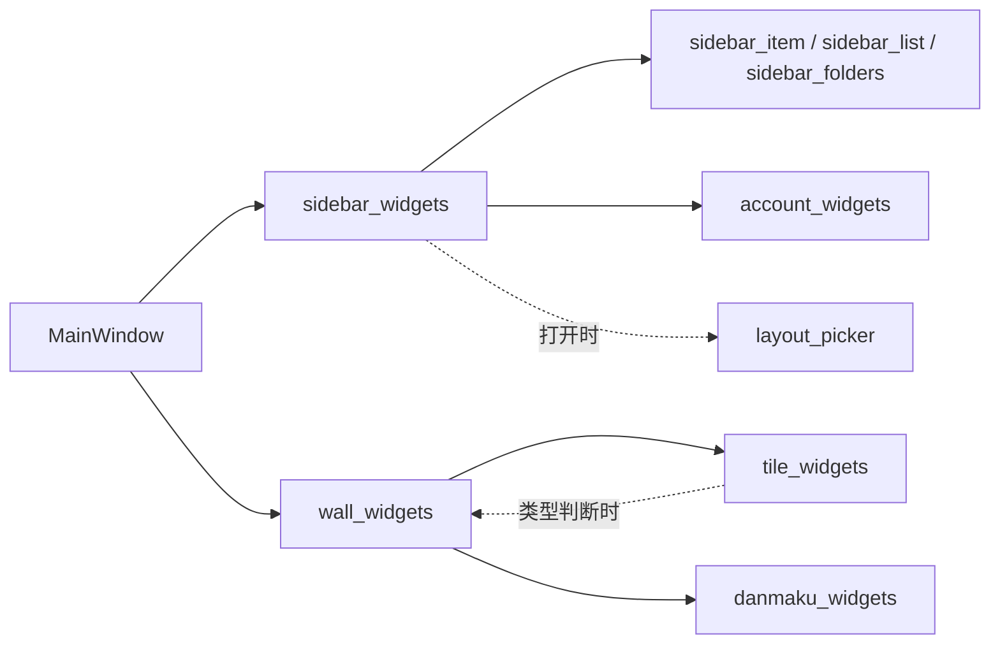

# 共用界面组件

统一调用入口为 `ddm.ui`。先检查这里和下表，再使用 Qt 原生控件或补充真正缺少的组件；颜色、字号、圆角和间距继续由 `ddm.theme` 管理，不在各页面另建配色表。

## 组件目录

| 组件 | 用途 | 原实现/维护位置 |
| --- | --- | --- |
| `ActionButton` | 设置页普通操作按钮，沿用 `IconButton` 样式 | `ddm/ui/basics.py` |
| `TitleLabel`、`HintLabel` | 设置标题、可换行说明，沿用 `SettingsTitle` / `SettingsHint` | `ddm/ui/basics.py` |
| `page_header` | 设置页标题加可选说明 | 从 dialogs 的 `_page_head` 集中提取；旧入口保持别名 |
| `step_button` | 原有 28×28 加减按钮，包含提示和点击回调 | 从 dialogs 的 `_step_button` 集中提取；旧入口保持别名 |
| `Avatar`、`RoomStrip`、`PinnedArc`、`circular_pixmap` | 头像、头像条、置顶标记、圆形图片 | `ddm/avatar_widgets.py` |
| `AnimatedDialog`、`AnimatedMenu` | 已有对话框和菜单的交互/动效 | `ddm/motion.py` |
| `ColorDialog` | 紧凑 RGB / HEX 选色与预览，确认时发出 `colorSelected`，复用现有主题和按钮 | `ddm/ui/color_dialog.py` |
| `SlidingTabs`、`SettingsStack` | 已有页签和设置页面切换 | `ddm/motion.py` |
| `TileButton`、`VolumeButton`、`RecordingButton` | 播放格按钮、音量、录制控件 | `ddm/playback_controls.py` |
| `SidebarToggleButton`、`PauseButton`、`RefreshButton`、`DanmakuToggleButton` | 已有侧栏/播放控制按钮 | `ddm/playback_controls.py` |
| `ElidedLabel`、`BarIconButton` | 省略文字、工具条按钮 | `ddm/ui/labels.py`、`ddm/ui/toolbar.py` |
| `continuous_path` | 矩形表面的连续圆角路径；保留圆形、胶囊及明确的直角 | `ddm/corner_geometry.py` |
| `ScaleCurveControl` | SC / 弹幕可拖动控制点的缩放曲线与比例示例 | `ddm/ui/scale_curve.py`；计算规则见 `ddm/viewport_scale.py` |
| `ToggleSwitch` | 设置行右侧的开关，保留 Qt 点击、空格键、焦点及禁用语义 | `ddm/ui/selection.py`；`NotificationSwitch` 保留兼容子类 |
| `SegmentedControl` | 单选分段组，共用底板与选中块，支持方向键切换及禁用项 | `ddm/ui/selection.py`；`value()` / `setValue()` / `valueChanged` |
| `DisclosureButton` | 页内展开条，统一焦点、按下、圆角与箭头绘制 | `ddm/ui/disclosure.py`；Qt 持有勾选值，固定控件高度 |
| `SettingsSurface` | 设置卡片的半透明渐变、高光和静态背景模糊缓存 | `ddm/ui/settings_surface.py`；供分组、通知及插件卡片复用 |
| `SelectControl` | 选项较多时使用的紧凑下拉，Qt 负责选择模型、弹层定位和键盘操作 | `ddm/ui/select.py`；沿用 `QComboBox` 的数据与信号接口 |

原有组件通过统一入口导出同一个类/函数对象，仍在原模块维护，不复制实现。原导入路径继续有效。播放器相关组件保留原有宿主、信号、原生窗口和生命周期要求，不是脱离业务上下文的通用播放框架。

选择控件的绘制集中在 `ddm/ui/selection.py`，尺寸由 `theme` 的开关令牌及 `CONTROL_HEIGHT` / `SEGMENT_*` 管理，颜色随深浅主题更新。`ToggleSwitch` 继承 `QCheckBox`，轨道和滑块由自身绘制；`SegmentedControl` 拥有一组互斥 `QAbstractButton`，Qt 选中状态是唯一值来源，`setValue` 不移动键盘焦点。两者标记 `customControlSurface`，通用圆角过滤器跳过这些控件的表面，避免额外复选指示器覆盖开关圆角；普通控件仍走原绘制路径。组件随 Qt 父控件销毁，不持有业务设置或创建定时器。常规与通知页共用开关，全局编解码的源格式接入分段组，原 `source_buttons` / `source_group` 仅为实际控件的兼容引用。

分段选中块使用渐变、上沿高光与轻投影表达微小高度差，底板使用凹槽明暗；这些是静态绘制，不改变按钮尺寸、状态或键盘行为。`SelectControl` 与 `FontSelectControl` 共用触发区和选项行绘制，列表沿用 Qt 弹层及父子生命周期，公共圆角与颜色跟随主题；弹层关闭或父控件销毁由 Qt 清理。全局解码方式接入下拉，并仅显示当前模式说明，展开选项不改变设置页几何尺寸。分段和下拉默认按内容宽度取尺寸，不随父布局横向铺满；编解码行将名称与控件分列，说明单独换行。其他按钮、输入框和滑块仍沿用原组件。

人工从根 `run.cmd` 检查常规与通知页开关左右端圆角、深浅色、鼠标／空格操作及禁用状态；展开编解码后检查源格式的凹槽底板、选中块高光、Tab／方向键与保存取消。解码列表应在触发框附近显示，选择后收起，Esc 取消，关闭设置后无残留列表；切换模式仅更新当前说明。100%／150%／200% 离屏回归和控件预览仅作为功能与绘制回归，实际系统缩放及真实界面仍待人工验收。

`ddm.ui` 按需加载头像、动效和播放控件；导入基础按钮/标签或上述播放控制按钮不会装载 `widgets`、播放器、主窗口或网页登录模块。播放按钮和音量弹窗集中在 `ddm/playback_controls.py`；`widgets` 保留原类及绘制辅助函数的兼容导出，刷新动画仍归按钮所有，音量弹窗仍归调用方持有。`ElidedLabel`、`BarIconButton` 由 `ddm/ui/labels.py`、`ddm/ui/toolbar.py` 维护，公共入口和旧 `widgets` 导出保持同一对象；导入它们也不会装载播放器或主窗口。使用明确的导入名称，避免 `from ddm.ui import *` 将全部组件一起载入。

## 播放界面设置与验收

`ddm/card_drop.py` 只负责松手后的短沉降前奏，最长 280 ms；首次画面提前就绪时立即结束。不监听或干预缓冲图标的显示，不绘制整格背景或彩色波纹，不等待首帧再淡出，加载与卡顿都由原播放器缓冲提示负责。动效窗口仅覆盖卡片运动区域，结束时先隐藏再释放图像；连续拖入、隐藏、移动、缩放、失焦、房间变化和销毁立即清理。关闭系统动画不创建过渡。

沉降以松手时的鼠标热点为缩放原点，保持水平落点，仅轻微下移，不向格子中央吸附。回归覆盖四角落点和 1×／2× 拖影，人工验收也应检查格子边缘松手的位置。

`ddm/tile_drag.py` 为墙内直播抓取关注栏同款卡片；没有对应关注项时用当前房间名、标题及缓存封面绘制卡片，不截取原生视频窗口。主窗口复用 `ddm/sidebar_drag.py` 的可见拖影、鼠标捕获、落点及 Esc 取消，以原 `TILE_MIME` 和 Move 动作交换格子；独立窗口原生拖拽也设置卡片图像和热点。拖动期间保留原播放器，松手才走原换格回调；释放鼠标捕获后再交换，墙内拖动结束不重排关注列表。来源图标保持无文字、无底色的中性圆角样式，真实头像到达后正常显示。

这部分只负责视觉反馈；房间分配、换格及播放仍由原入口处理。离屏和本地视频仅用于功能回归，不代表真实拖动手感或性能验收。人工从根 `run.cmd` 拖入关注卡片，检查短前奏结束后使用原缓冲标识，播放后中央无残留黑块；按住墙内直播移动鼠标，应抓起可见卡片，原格继续播放，松手交换而 Esc 取消。连续拖入、失败、缩放和关闭窗口应清理拖影。截图黑块没有实播复现证据，不将自动验证写为黑块已人工验收；需复核真实播放和不同 DPI。

设置分类导航采用关注栏风格，在 `ddm/settings_navigation.py` 维护：基础偏好、观看与互动、系统与扩展三组，分类名称支持中文／拼音搜索。完整分类栏宽 224 px，由标题右侧常显按钮手动收成 58 px 图标栏，再次点击同一按钮展开；鼠标位置和停留不控制收展。按钮图形、提示与无障碍名称随状态更新，支持 Tab 聚焦、空格触发，分类方向键不自动展开。收起清空分类筛选，保持全部分类与更新红点可访问。页面顺序、懒创建、配置与取消语义保持原有接口。

设置导航不创建指针轮询定时器或应用级事件过滤器。按钮过渡复用现有曲线，200 ms，可从当前宽度反向，关闭系统动画时直接切换；窗口隐藏时停止过渡并落到手动选择的宽度，同一窗口重新显示时保持该选择。人工验收：内容区停留超过两秒、返回左栏均不应自动收展；点击按钮、用空格触发、切换分类和修改设置，确认状态、搜索、未保存值与按钮提示正常。

SC 和画面弹幕使用控制点曲线：横轴为画面高度 0–1440 px，纵轴为相对手动大小的比例 10%–200%，720 px / 100% 为固定基准。拖动节点调整，拖动线条新增节点，右键或 Delete 删除选中的中间节点；端点仅上下移动。超过 1440 px 使用最右端比例。设置 → 弹幕中分别编辑，格内观看设置也提供同一曲线，并沿用全局／逐格独立设置。已有缩放强度转换为初始曲线；没有曲线数据时继续使用旧强度计算。SC 布局仍受容器宽高及消息数量限制，比例示例不代表拥挤时的最终大小。

设置 → 托盘行为 → 画面右键菜单左右并排：左侧为菜单缩略图，直接拖动功能行排序；右侧勾选功能并实时更新预览。仍支持上移／下移与恢复默认。插件扩展按一组参与排序；全屏及画中画继续隐藏不适用的菜单项。

从根目录运行 `run.cmd --check-ui-polish` 可检查透明边缘、底栏背景、历史消息按钮、缩放与菜单配置。真实界面人工验收步骤：

1. 在 100%、125%、150% 系统缩放下悬停播放格，检查 LIVE／标题胶囊边缘和底栏按钮蓝色背景；切换深浅主题后仍应平滑。
2. 滚动弹幕到历史位置，等待新消息和表情图片刷新；“回到底部”按钮应一直固定在可见区域，点击后恢复跟随并隐藏。
3. 在 SC／弹幕曲线上拖动一个节点，在线上新增节点并右键删除；改变格子大小，核对文字变化、保存重开、曲线重置，以及弹幕独立设置与全局设置。
4. 在托盘行为页右侧取消一个菜单功能，在左侧缩略图上将另一项拖到顶部；保存后打开画面右键菜单，检查可见项、顺序、点击功能及恢复默认。

### 设置内容布局

`ddm/settings_layout.py` 仅负责设置卡片和响应式排列，控件、信号和保存仍由各页面持有。设置默认宽 1200、高 800，受当前屏幕可用范围限制；右侧内容区达到 760 px 时两列排列，否则上下堆叠。常规、弹幕、录制、通知、快捷键和嵌入式分区样式复用原控件分组；SC 曲线与位置预览并排。曲线等复杂内容可跨列，普通设置卡片按内容收高；设置修改自动保存。

常规页原 grid 和隐藏平台标识 anchor 保留，兼容已发布插件的插入、保存、取消和重置。不得以复制控件或另建状态副本实现布局切换。

常规页顶部仍为“播放与声音／关注与预览”双列，设置行左侧显示名称、右侧复用共用 `ToggleSwitch` 开关或数值控件；初始音量紧随初始静音。两卡采用 `QSizePolicy.Maximum`，`SettingsColumns` 对该策略的卡片按内容高度顶部对齐，其他页面保持原有排列。编解码按钮在左卡内展开 `ddm/settings_codec_editor.py` 的 `InlineCodecEditor`：直播源格式为三项分段选择，本机解码使用五项下拉选择并显示当前项说明，无第二层设置窗口。草稿只由编辑器中的选中控件持有，常规页读取其值统一保存、取消和重置；单窗编解码弹窗仍使用原 `CodecSettingsPanel`。展开时刷新卡片布局项，避免 Qt 缓存收起高度造成内容裁切。收起、切页及缩放不丢失编辑值，新建设置窗口默认收起。

本批人工验收：从根 `run.cmd` 打开设置，检查顶部两列名称和右侧控件；点击编解码摘要，应原地展开且右卡不随之增高。选择 HEVC 和 CPU 解码，收起／展开、切页及缩窄窗口后值应保留；取消后重开恢复原设置，保存后重开保留选择，恢复本页默认应同步摘要与单选状态。检查平台插件插入项仍可见、可保存。离屏截图和自动回归不代替本项人工验收。

人工验收：从根目录 `run.cmd` 打开设置，检查宽窗口各卡片并排；缩到 760 px 宽时应改为上下排列并能滚动到末项。修改音量、SC 曲线、录制目录、快捷键及菜单顺序，切换页面和窗口宽度后值应保持；分别验证取消、保存重开和当前页重置。外观页左右预览与选项应联动，插件平台标识应仍可保存。自动几何回归通过不代表人工验收完成。

## 调用示例

```python
from PySide6.QtWidgets import QWidget, QVBoxLayout
from ddm.ui import ActionButton, HintLabel, page_header

page = QWidget()
layout = QVBoxLayout(page)
layout.addLayout(page_header('图片缓存', '选择需要清理的图片类别'))
status = HintLabel('尚未统计', page)
button = ActionButton('刷新统计', page)
button.clicked.connect(refresh_cache)  # 页面自己的业务函数
layout.addWidget(status)
layout.addWidget(button)
```

调用现有头像或菜单：

```python
from ddm.ui import Avatar, AnimatedMenu

# 使用原构造参数与信号；具体业务状态由页面提供。
# 两个名称分别指向 avatar_widgets.Avatar 与 motion.AnimatedMenu。
```

主题颜色直接读取当前主题，例如 `theme.ACCENT`（主题蓝）、`theme.SUCCESS`（现有绿色）。用 QPainter 绘制 `rgba(...)` 颜色时走 `theme.qcolor()`，不要将 CSS rgba 字符串直接传给 QColor。缓存饼图使用蓝/绿两类，灰色仅用于空状态、辅助文字和边界。

已接入：设置页公共页头和加减按钮、数据与存储页、图片缓存页。以后修改共用样式应修改 `theme.py`；组件行为在实际维护模块修改，并通过统一入口验证兼容性。业务页面如录制管理、账号窗口、缓存管理器仍各自维护，不整体搬入基础组件入口。

## 验证

矩形控件的底色与描边通过 `ddm/continuous_corners.py` 统一绘制，Qt 继续负责原有文字、输入、操作及布局。主题 QSS 仍是颜色、半径、状态和尺寸的来源；自绘卡片与图片裁切使用 `continuous_path`，不在各页面另造曲线。当前曲线是带连续曲率接点的近似外形，并非 Apple 私有路径的逐点复刻。圆形头像、状态圆点、胶囊和 Windows 系统窗口外框保持原形。

功能轨使用 34×34 按钮和 6px 间隔；顶部和底部各组间的弹性空白继续用于分组。皮肤或控件的原半径与颜色仍生效，不统一改成同一个半径。

```powershell
python dev/run_checks.py --script selfcheck_ui_components
run.cmd --check-continuous-corners
run.cmd --check-playback-controls
run.cmd --check-image-cache
```

组件专项验证轻量导入、原对象身份、旧导入兼容、按钮信号/禁用/归属、标题/说明样式与旧设置入口、实际页面采用共用控件及主题切换；使用离屏 Qt、临时数据，不读取用户账号、不联网。播放按钮专项另检查音量滚轮上下限、声道提示、暂停/方向/弹幕开关、刷新动画显隐与销毁、多缩放绘制；这些回归不代表实际直播性能验收。

弹幕/SC展示在 `ddm/danmaku_widgets.py`，账号行在 `ddm/account_widgets.py`，关注卡片与列表在 `ddm/sidebar_item.py`、`sidebar_thumbnail.py`、`sidebar_list.py`，文件夹控件在 `sidebar_folders.py`，开播动效在 `live_alert.py`，`sidebar_cards.py` 仅作兼容导出，布局选择器在 `ddm/layout_picker.py`。这些业务组件保留 `ddm.widgets` 原导入，状态与信号不迁移到新的通用控制器。`widget_support` 仅维护共用常量与绘制辅助；连接、账号和播放器仍归原宿主。


## 业务控件的维护边界

| 职责 | 维护模块 | 保留的状态/生命周期 |
| --- | --- | --- |
| 弹幕面板、文档、阅读位置、SC卡片 | `danmaku_widgets` / `danmaku_document` / `danmaku_scrolling` / `super_chat_widgets` | 面板持有消息、图片加载器和Qt子控件；连接/快照仍由宿主协调 |
| 账号行及账号菜单绘制 | `ddm/account_widgets.py` | 不接管登录、账号存储或刷新线程 |
| 关注卡片、文件夹控件、列表排版 | `sidebar_item` / `sidebar_thumbnail` / `sidebar_folders` / `sidebar_list` | 原卡片/列表对象、预览播放器和动画归属不变 |
| 关注栏协调、筛选和导航接线 | `ddm/sidebar_widgets.py` | 原Sidebar状态及对卡片/拖动会话的引用不复制 |
| 单格视频、浮层和播放控件 | `ddm/tile_widgets.py` | 格子和播放器引用保留；启动解析、恢复和退出仍由原宿主负责 |
| 画面墙、分区、换格和尺寸预览 | `ddm/wall_widgets.py` | 原Tile对象身份和Qt父子关系不变 |
| 布局选择器 | `ddm/layout_picker.py` | 仅选择界面和信号 |
| 共有几何常量、图像/样式辅助 | `ddm/widget_support.py` | 不持有窗口、播放器或业务状态 |

项目内部直接导入上述模块，`ddm.widgets` 供旧调用方兼容使用，按原顺序导出同一类对象。职责模块在导入时不反向依赖兼容入口。原有工厂或函数有实际替换调用方时，由宿主传入；需要保留公开模块替换契约的整类实现，在动作发生时局部读取旧入口，避免模块初始化循环。Sidebar在打开选择器时导入LayoutPicker，Tile在计算画面墙音量控件宽度时导入WallGrid；不新增通用宿主接口或重复控制器。结构拆分不代表性能提升。



### 画面墙边框交互

`ddm/wall_border.py` 维护 `WallPaneBorder`、`WallResizePreview` 和 `WallBorderInteraction`。交互对象管理一次悬停/拖动的状态、待处理指针位置、合并定时器和预览引用；画面墙管理布局模型及最终比例，原有 `_begin/_move/_finish/_cancel_border_drag` 入口继续委托到交互对象。旧 `ddm.widgets` 和 `ddm.wall_widgets` 的边框类导入身份不变。

拖动预览不调整视频格几何；松开才应用最终比例并发保存信号。换布局、隐藏、关闭与删除时保留原清理路径。预览的Qt父对象仍为画面墙，边框仍为格子；合并定时器改归交互对象，随整个画面墙销毁。布局算法、32ms间隔、预览绘制与交互行为均沿用原实现，不作为性能优化。

设置页面按职责维护于 `ddm/settings_*.py`：常规/编解码/托盘、通知、快捷键、弹幕、录制、插件、外观；共享的响应式布局仍由 `settings_layout` 负责。`ddm/dialogs.py` 保留 `SettingsDialog` 及旧导出，类身份、Qt父对象、页面懒加载和工厂替换入口不变。常规页直接使用 `InlineCodecEditor`；单窗编解码对话框继续保留旧导出，独立模块导入不依赖聚合入口。

`ddm/add_room_dialog.py` 提供 `AddRoomDialog`，`ddm/room_dialogs.py` 维护 `FollowImportDialog` 并保留旧导出，`room_folder_controls.py` 维护共用文件夹动作；不加载设置页面或播放器。`dialogs.py` 留存设置窗口协调和兼容导出，独立房间对话框的Qt父子关系、搜索/勾选/目标文件夹及异步回填规则保持。

`sidebar_folders` 维护 `SmartFolderDialog`、`SmartFolderCard`、`FollowFolderButton`，类体保持不变；智能文件夹仅复用原卡片的房间数据、操作和绘制，不新增关注或播放器状态。悬停预览定时器归显示副本，隐藏时停止，父对象销毁后随Qt子对象释放。旧 `sidebar_cards` / `widgets` 的类身份保持。

`sidebar_cards.py` 现只保留兼容导出；`LiveAlert`、`NavThumb`、卡片本体/多选勾选框、列表/轮播容器分别由 `live_alert`、`sidebar_thumbnail`、`sidebar_item`、`sidebar_list` 维护。六个类体AST不变，原生预览播放器、动画/定时器、状态和Qt父子关系仍归原对象；侧栏、悬停预览与拖动诊断直接依赖职责模块。旧测试对私有播放器工厂/样式函数的替身指向新维护模块，未改断言。


## 全量功能职责边界

本轮复核覆盖主窗口、关注栏、播放格、画面墙、弹幕/SC、小窗、录制、插件、在线更新、登录、图片、皮肤及独立设置进程。具体入口见[仓库职责地图](../repository-map.md)。可独立变化的展示、协调、协议、数据与工作线程已分开维护；兼容宿主仍负责组装、Qt 事件和旧方法委托。

### 状态及兼容约束

- 主窗口唯一持有播放器/解析器映射、任务代次、设置、录制与关停状态；Sidebar、Tile、WallGrid 继续持有原 Qt 子控件和定时器。领域协调器只引用宿主，不复制这些可变数据。
- `WallBorderInteraction` 继续独占一次拖边会话及其定时器。浮动小窗继续借用原播放格，退出时沿原路径归还，不创建第二套播放器。
- B 站和图片工作线程在运行时读取原 API 模块，保持凭据、路径、缓存代次及已有替换点的唯一来源。浏览器 profile、在线退役任务集、插件注册表保持同一对象。
- `widgets`、`sidebar_cards`、`dialogs`、`online_ui`、`super_chat` 等旧导出保持原类身份；Qt 回调签名、父对象、旧导出身份、继承关系、懒加载、关闭顺序和时序参数保持。源方法/完整类的迁移做过 AST 等价核对，工厂绑定及明确的兼容查找单独校验。
- 结构拆分不等于性能改进；本轮回归仅验证行为和维护边界。

### 继续保留的较长模块

| 模块 | 保留依据 |
| --- | --- |
| `app.py`、`sidebar_widgets.py`、`tile_widgets.py`、`wall_widgets.py` | Qt 宿主、控件组装、事件/状态快照/关停以及显式兼容委托；具体业务已转至职责模块 |
| `theme.py` | 主题资源、令牌与 QSS；长样式文本仍属于统一外观职责 |
| `sidebar_orientation.py`、`tile_presentation.py`、`wall_layout.py` | 分别负责横竖布局借用、播放格显示几何、画面墙几何；宿主状态没有复制到控制器，SidebarPresentation 已降为兼容协调入口 |
| `bili.py` | B 站 HTTP 协议及统一凭据；Qt 工作线程已独立，避免为端点拆分而复制凭据/请求缓存 |
| `stream_playback.py`、`recording.py`、`player.py` | 播放协调、录制协调和单个 mpv 后端生命周期；数据/参数/协议/回放等已分别下沉 |
| `video_danmaku.py`、`video_danmaku_quick.py` | 分别为弹幕准入/轨道时钟和 Quick 合成层；光栅任务、表面接线及 SC 画笔已独立 |
| `pip_window.py`、`account_dialog.py`、`skin_part_settings.py`、`notification_center.py` | 各自完整的具体窗口或界面功能；不为行数继续切碎同一控件行为 |
| `super_chat_preview.py`、`sidebar_item.py`、`sidebar_thumbnail.py` | 对应 SC 设置预览、关注卡片和缩略图绘制；SC 运行时折叠、头像资源与布局已另有模块，SuperChatPresentation 旧模块仅兼容导出 |
| `drag_diagnostics.py`、`folder_motion_capture.py` | 各自专项采集与输出；通用 Probe、主题采集已独立，responsiveness 只保留安装协调与旧导出 |
| `online_tasks.py`、`cache_settings.py`、`skin_background.py` | 本地 Qt 异步适配与其生命周期紧密相连；实际外部协议/缓存操作/素材校验在独立模块，短适配任务不另建通用框架 |

### 验证及人工验收

`run.cmd --check-functional-modules` 覆盖职责模块独立导入、旧对象身份、唯一宿主/集合、Qt 父子关系、原工厂、迟到结果交付、取消以及本地插件 ZIP 安装/删除。每个 Qt 用例使用独立进程和临时数据，不读取真实账号或发送弹幕；这些检查已纳入 smoke/offline。

从根 `run.cmd` 人工检查：关注栏筛选/文件夹/多选拖放；播放格画质、音量、弹幕与全屏；边框/角点拖动松开与取消、换布局；小窗选择和归还；设置保存/取消与皮肤预览；本机录制/回放结束后的清理。预期行为与拆分前一致。原生高 DPI、真实播放及账号平台可用性须与自动回归分别记录。历史脚本的旧断言、插件/发布产物前置依赖和原生后端限制不计为通过，也不为结构拆分删断言。


### 六处后续细分

第一轮清单完成不表示所有领域都已达到合适粒度。后续复核明确的六处已继续按以下边界拆分：

| 原模块 | 具体维护位置 | 原入口/状态 |
| --- | --- | --- |
| RoomPlacement | `room_catalog`、`room_navigation`、`watch_history_sampling` | 格子放置/互换仍在 RoomPlacement，旧目录/导航方法薄委托；三者使用原窗口与 WatchHistory |
| config | `room_configuration` | 配置路径、读写和设置定义留 config；房间整理/平台挂起恢复/启动占位数据独立，读取当前配置默认值而非复制 |
| super_chat_presentation | `super_chat_layout`、`super_chat_animation`、`super_chat_avatar`、`super_chat_preview` | 旧类和函数兼容导出；预览独立于运行时期限与头像资源，Qt 父对象和定时参数沿用原实现 |
| sidebar_presentation | `sidebar_orientation`、`sidebar_collapse`、`sidebar_layout_picker` | 账号形状复用 SidebarAccountControl，焦点复用 SidebarInteraction；原 Sidebar 控件/动画/计时器/状态仍唯一持有 |
| responsiveness | `responsiveness_probe`、`folder_motion_capture`、`theme_capture` | 通用探针、文件夹动画、主题动画分离；旧 Probe/工厂替换点、输出/隐私/采样参数保持 |
| online | `release_repository`、`app_release_api`、`plugin_catalog_api`、`verified_download` | 官方仓库 HTTP/元数据校验、本体版本、插件缓存、文件下载分离；online 保留公开替换入口，缓存仍由调用者传入 |

新增边界用例验证配置往返及输入不变、当前默认值、独立导入、原导出身份、原工厂替换和唯一 Qt/宿主归属。旧结构检查更新为断言明确的领域组件集合，每个组件仍只能引用原宿主；未移除业务断言。本轮没有改动业务算法、采样/折叠/重试参数，也不作为性能提升。

设置分组、通知和插件卡片共用 `SettingsSurface`。设置窗口内使用均匀的不透明卡片和柔和外投影；设置以外的表面继续沿用静态图片模糊、半透明渐变和细边缘高光。图片模糊按路径、修改时间及大小缓存（最多4张），不抓取窗口，不对卡片内容或子控件添加图形效果，不引入定时器。

设置基础色由 `settings_material.BASE_COLORS` 统一持有：浅色底板/卡片/控件分别为 `#EEEDF4`、`#FFFFFF`、`#EDECEF`，深色分别为 `#33373B`、`#3C4044`、`#43444B`。关闭毛玻璃时底板与卡片不透明；开启时由 `settings_backdrop.apply_blur` 使用 Windows 合成器模糊 HWND 背后的实时内容，`settings_material_paint.glass_tint` 只绘制底色蒙版，卡片加18%表面底色，阴影裁切在卡片外侧，避免透进透明内容区。不开截图轮询，不模糊控件，不修改 Qt flags、原生父子关系或 HWND。系统模糊半径不可调，旧 settings_glass_blur 仅保留数据兼容；UI 只显示底色不透明度。不支持的后端回退纯色。

设置整窗由 `ddm/settings_window.py` 管理无边框 QDialog、不透明基础底板、可拖动顶部栏、常显搜索及圆形关闭按钮；`SettingsDialog` 保留设置协调职责和旧入口。顶部关闭和 Esc 等待自动保存协调器确认后完成关闭，顶部空白和边缘使用Qt系统移动/缩放。`settings_backdrop.apply_frame` 在Windows 11保留DWM原生圆角及深浅色边框属性，明确使用DWMSBT_NONE，客户区扩展边距为0；初始化按HWND缓存，切主题只更新颜色，不重建窗口。原生圆角可用时由DWM统一裁切，不再叠画第二套客户端圆角/描边或硬mask；其他环境使用连续圆角自绘。

设置窗内的SettingsSurface在同一绘制事件中先画卡片外的低透明度软投影，再画均匀不透明底色；投影占用原有卡片边缘内的少量空隙，既有控件位置及布局项保持不变。阴影关闭时只跳过投影，卡片底色和正文不变。独立进程宿主页仍由主进程持有，工作进程容器管理其大小与可见性；宿主首次显示的尺寸确认保留。

编解码收展使用 SettingsColumns.refresh_section，只替换发生尺寸变化的 Qt 布局项，保留其余卡片的布局项与控件身份，避免先强制子布局再重建全部分组。无新增动画或设置状态副本。

设置自动保存由 `ddm/settings_autosave.py` 持有单个定时器和一个在途增量，确认基线只在回执成功后前进；250 ms 合并普通输入，滑块拖动期间不发送，松手和输入完成刷新。惰性页只在创建时接管自身初值，不把打开页面当作修改；窗口关闭等待最后一次本地及宿主保存；关闭完成前停止定时器并移除事件过滤器，复用的更新页面移回主窗口后不再向已关闭设置发送保存。底部操作栏移除，恢复默认、保存状态和失败重试位于页标题旁；原 confirm_button 仅作为显式重启／迁移操作，不用于普通保存。

`ddm/settings_autosave_apply.py` 复用主窗口原有应用入口，不关闭窗口、不隐式准备迁移或重启。独立窗口发送 auto-save 增量，由主进程应用后回复 auto-saved；宿主页面另行确认 host-flush 完成才解绑原生窗口。运行时与外部状态以主窗口为准，发送端只提交实际变化字段；旧平台插件贡献的复选框发送整组有效值，并沿用 accepted 保存通知（发信号，不调用 accept 关闭）。配置保存可选择 raise_errors=True 反馈写入失败，默认调用保留原异常处理。失败字段即便改回原值也会重送，避免把运行时或失败写入当成已保存。更新安装、数据迁移和插件重启仍走明确动作入口；预览和未绑定协调器的独立控件不写配置。

设置页的外观模式选择直接原地应用调色板，先结束尚在运行的主题覆盖层，不创建整窗波纹；主界面的主题入口仍使用原切换动画。原生设置边框按HWND复用初始化，自动保存与独立进程主题同步沿用原流程。

设置绘制属性由 `ddm/settings_material.py` 规范化，`settings_material_editor.py` 提供实时毛玻璃、底色不透明度、阴影、滑动分段与卡片排列。系统玻璃开关及参数共组，明确模糊程度由系统控制，不再依赖固定图片。保存和重开沿用原协调器。

系统圆角与材质分离：DWM 轮廓继续沿用，独立于合成器模糊开关；SettingsSurface、分段选项及下拉弹出控件读取所属设置窗口／宿主stack的阴影属性。

独立设置进程在host-page请求中交付外壳HWND。SettingsHost先通过QWindow.fromWinId保存外壳引用，并将真实内容窗口的Qt父窗口设为外壳，再发送host-ready供工作进程创建容器；容器统一管理内容几何与可见性，host-attached仍只确认初始尺寸。这样透明分层窗口首次重绘和后续重绘都使用子窗口坐标，避免Qt仍按顶层屏幕坐标刷新而重复加上外壳位置。关闭时先脱离外部QWindow，再归还QWidget父对象并释放引用；不复制页面状态，不再用Win32手动纠偏或定时器对齐。


常规页以播放与声音、关注与预览、编解码组成紧凑两列，卡片按内容高度顶部对齐；曲线等复杂编辑内容可跨列。编解码直接显示页面内编辑器，不再通过展开条挤动其他设置。

外观页的主题与视觉效果同样使用顶部对齐的紧凑两列卡片；主题复用260px分段选择，外部主题同步不重复发出保存信号。下方界面预览与分区编辑合并为一张卡片，内部左右分区，窄窗上下排列；卡片顶部工具栏将当前分区恢复按钮放在180px场景下拉左侧，复用原背景及分区重置处理。背景遮罩复用短滑条与加粗数值，视频启用复用ToggleSwitch。分区草稿及自动保存仍由原编辑器和设置协调器持有。

`ddm/settings_contributions.py` 只负责旧常规页网格贡献项的入框：保留 `page.layout().itemAt(1).layout()` 和隐藏平台 Logo anchor，在布局请求或保存快照时把追加项移入“平台显示与插件扩展”卡片。原控件、嵌套布局、信号、值和显式隐藏状态保持；卡片不复制设置状态、不保存配置。普通对话框、`settings_host` 和独立 worker 通过 `GeneralSettingsPage.plugin_controls()` 获取同一批具名复选框，自动保存继续使用原确认／回执和插件钩子。没有贡献项时不显示空卡片。


`ui.StepperControl` 为已有 QSpinBox／QDoubleSpinBox 提供单一底色和两端步进按钮；数值、范围、后缀、输入与键盘行为仍由原 Qt 编辑器持有，不创建第二份数值状态。它使用独立样式清除子输入框的重复边框，支持长按与边界禁用，常规页关注刷新和自动紧凑阈值复用同一控件；关闭自动紧凑时禁用整个步进控件。

音量均衡编辑器在内容宽度达到780px时左侧放参数、右侧放曲线，窄窗纵排；预设复用SelectControl。总开关不禁用草稿编辑，是否处理音频仍由原播放器设置决定。AudioNormalizationEditor.changed在曲线值实际变化时发出，预设选择、手动输入、拖动和恢复默认统一走该信号供自动保存观察；没有复制播放状态或改变响应计算。


设置数值与曲线共用以下展示约定：`SettingsSlider` 固定160逻辑像素，`SettingsValueLabel` 固定40像素并使用TEXT1加粗；`StepperControl` 默认180像素，内部原Qt数值编辑器自适应，外层细描边、轻渐变与独立软投影，悬停反馈160ms。阴影沿用settings_no_shadows开关；没有QGraphicsEffect或子控件快照。`section_grid`和旧插件贡献项入框时保留原布局项的alignment，因此个别自定义宽度仍能保持右端对齐。

`settings_focus.SettingsInputFocus` 仅观察所属设置根节点的鼠标按下，在点击其他控件或空白时释放旧焦点；无边框外壳和跨进程宿主stack各自持有过滤器，不改变原生窗口几何。Stepper清理非编辑状态的文本选区，保留当前编辑框及其文本菜单内的选择，按加减也不遗留单位蓝块。数值与保存仍由原控件/协调器持有。

ToggleSwitch的鼠标切换以250ms缓动绘制圆点位置和轨道颜色，使用参考Radio.vue的强调曲线；状态信号即时发送，快速反向从当前进度继续，键盘、程序设置及Windows关闭系统动画时直接到位，隐藏时停表并归位。Stepper悬停复用160ms和既有强ease-out参数，不改变控件尺寸或命中范围。

`ui.curve_surface.paint_curve_surface` 统一绘制曲线区的独立圆角底板、较深绘图区和10等分细网格；缩放曲线和根集成版的音量响应预览复用。普通节点白色填充与主题色描边，固定720px/100%节点及原数据语义保留；禁用时保持区域对比，只淡化轴、曲线和节点。缩放图的右侧坐标留出24px避免裁切；拖动、增删和缩放计算沿用各自图控件。


外观偏好由appearance_preferences校验主题色与界面字体，theme持有已应用的令牌；主题色按深浅背景修正对比度，默认色不变，字体不覆盖独立弹幕字体。settings_theme_editor只持有表单草稿，仍由原自动保存协调器持久化；宿主和独立设置进程同步这些值；旧静态背景路径继续兼容传递但不再用于毛玻璃绘制。

settings_card_layout支持auto与vertical，SettingsColumns按窗口偏好排列卡片；新建懒加载页也遵循偏好。预览与编辑等复杂卡片的内部两栏使用respect_preference=False，仍按可用宽度排布。settings_segment_motion仅控制共享SegmentedControl鼠标选中底片的250ms位移，复用已有强ease-out；快速反向从当前矩形继续，键盘／程序设置／减少动画直达，隐藏和尺寸变化停止并归位，状态信号即时发送。

skin_gallery只列出已导入utils/skins中的本地图片／视频，使用缩略图与选中描边，复用原背景加载和插件所有权；视频使用类型图标，不另起预览播放器。skin_mask_enabled关闭时保留skin_mask数值、渲染使用零遮罩，重新开启恢复强度；旧版皮肤插件的锁定语义保持。音量均衡开关与说明紧邻排列。


外观字体参数包含appearance_font_size（11–20px，默认13），configure_appearance同步字体层级令牌；theme仅在字体/字号变化时同步刷新已有控件的字体样式，深浅色或分段开关不触发这次字体刷新。分类列表按相同令牌绘制，预览示意图的内部画布文字保持固定比例。主题色默认按钮共用自绘色块，避免原生按钮padding挤掉文字。

SettingsInputFocus同时承担设置根内的滚轮路由：启用的横向滑条保留原Qt调值，步进/关闭下拉/纵向条把事件交给外层QScrollArea；嵌套列表能滚动时保留自身滚动，到边界才交给页面。弹出的下拉列表保留原生浏览。该过滤器不碰原生窗口归属或坐标。

分段鼠标焦点框不再先于底片出现，文字强调色按移动底片裁切，键盘焦点与即时状态保留。设置协调器仅对实际变化全部属于材质/主题字体的保存跳过apply_danmaku_settings，其他保存和插件变更保留原调用行为；本体/独立设置进程继续复用同一保存通道。

正常自动保存不显示顶部状态，当前页恢复按钮保留内部兼容入口但隐藏；出错状态和重试仍可见。纵向布局窗口默认1040px，切换布局时只调整窗口尺寸，不改变窗口flags或原生归属。图库增加打开导入目录与文件类型/完整路径/时间提示，文件不清理；实时毛玻璃参数放在其开关下方并标明系统控制及纯色回退。

弹幕页由 `settings_danmaku.DanmakuSettingsPage` 持有控件、SC 预览、缩放曲线和 values/reset；dialogs 保留同类兼容导出。`FontSelectControl` 在共享下拉上保留 currentFont/setCurrentFont/currentFontChanged 契约；步进和开关使用共享组件。字体/屏蔽与 SC 显示为紧凑卡片，复杂 SC 卡片内部左参数/曲线、右位置预览；画面弹幕缩放也分说明/曲线两栏，窄窗上下排列。SC 预览仍独立维护位置、同步和共用大小，无业务状态副本。根与源的其他设置页及宿主协调仍保持各自职责边界，本轮不迁移。
大字号下，SettingsValueLabel 按实际百分比文字度量宽度，ScaleCurveGraph 的坐标轴边距及行高跟随字体，避免20px时裁切百分比与轴标签；滑条本身仍保持统一长度。
