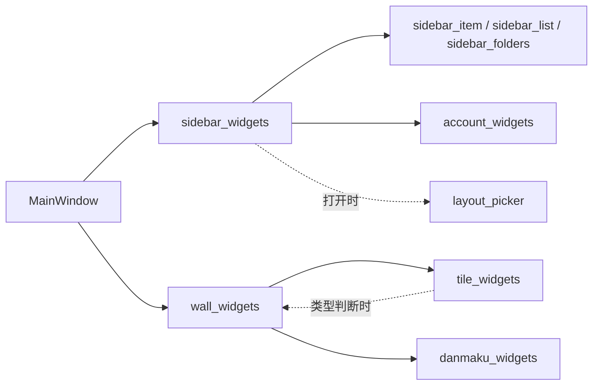

# 共用界面组件

统一调用入口为 `ddm.ui`。先检查这里和下表，再使用 Qt 原生控件或补充真正缺少的组件；颜色、字号、圆角和间距继续由 `ddm.theme` 管理，不在各页面另建配色表。

## 组件目录

| 组件 | 用途 | 原实现/维护位置 |
| --- | --- | --- |
| `ActionButton` | 设置页普通操作按钮，沿用 `IconButton` 样式 | `ddm/ui/basics.py` |
| `TitleLabel`、`HintLabel` | 设置标题、可换行说明，沿用 `SettingsTitle` / `SettingsHint` | `ddm/ui/basics.py` |
| `page_header` | 设置页标题加可选说明 | 从 dialogs 的 `_page_head` 集中提取；旧入口保持别名 |
| `step_button` | 原有 28×28 加减按钮，包含提示和点击回调 | 从 dialogs 的 `_step_button` 集中提取；旧入口保持别名 |
| `Avatar`、`RoomStrip`、`PinnedArc`、`circular_pixmap` | 头像、头像条、置顶标记、圆形图片 | `ddm/avatar_widgets.py` |
| `AnimatedDialog`、`AnimatedMenu` | 已有对话框和菜单的交互/动效 | `ddm/motion.py` |
| `ColorDialog` | 紧凑 RGB / HEX 选色与预览，确认时发出 `colorSelected`，复用现有主题和按钮 | `ddm/ui/color_dialog.py` |
| `SlidingTabs`、`SettingsStack` | 已有页签和设置页面切换 | `ddm/motion.py` |
| `TileButton`、`VolumeButton`、`RecordingButton` | 播放格按钮、音量、录制控件 | `ddm/playback_controls.py` |
| `SidebarToggleButton`、`PauseButton`、`RefreshButton`、`DanmakuToggleButton` | 已有侧栏/播放控制按钮 | `ddm/playback_controls.py` |
| `ElidedLabel`、`BarIconButton` | 省略文字、工具条按钮 | `ddm/ui/labels.py`、`ddm/ui/toolbar.py` |
| `continuous_path` | 矩形表面的连续圆角路径；保留圆形、胶囊及明确的直角 | `ddm/corner_geometry.py` |
| `ScaleCurveControl` | SC / 弹幕可拖动控制点的缩放曲线与比例示例 | `ddm/ui/scale_curve.py`；计算规则见 `ddm/viewport_scale.py` |

原有组件通过统一入口导出同一个类/函数对象，仍在原模块维护，不复制实现。原导入路径继续有效。播放器相关组件保留原有宿主、信号、原生窗口和生命周期要求，不是脱离业务上下文的通用播放框架。

`ddm.ui` 按需加载头像、动效和播放控件；导入基础按钮/标签或上述播放控制按钮不会装载 `widgets`、播放器、主窗口或网页登录模块。播放按钮和音量弹窗集中在 `ddm/playback_controls.py`；`widgets` 保留原类及绘制辅助函数的兼容导出，刷新动画仍归按钮所有，音量弹窗仍归调用方持有。`ElidedLabel`、`BarIconButton` 由 `ddm/ui/labels.py`、`ddm/ui/toolbar.py` 维护，公共入口和旧 `widgets` 导出保持同一对象；导入它们也不会装载播放器或主窗口。使用明确的导入名称，避免 `from ddm.ui import *` 将全部组件一起载入。

## 播放界面设置与验收

`ddm/card_drop.py` 只负责松手后的短沉降前奏，最长 280 ms；首次画面提前就绪时立即结束。不监听或干预缓冲图标的显示，不绘制整格背景或彩色波纹，不等待首帧再淡出，加载与卡顿都由原播放器缓冲提示负责。动效窗口仅覆盖卡片运动区域，结束时先隐藏再释放图像；连续拖入、隐藏、移动、缩放、失焦、房间变化和销毁立即清理。关闭系统动画不创建过渡。

`ddm/tile_drag.py` 为墙内直播抓取关注栏同款卡片；没有对应关注项时用当前房间名、标题及缓存封面绘制卡片，不截取原生视频窗口。主窗口复用 `ddm/sidebar_drag.py` 的可见拖影、鼠标捕获、落点及 Esc 取消，以原 `TILE_MIME` 和 Move 动作交换格子；独立窗口原生拖拽也设置卡片图像和热点。拖动期间保留原播放器，松手才走原换格回调；释放鼠标捕获后再交换，墙内拖动结束不重排关注列表。来源图标保持无文字、无底色的中性圆角样式，真实头像到达后正常显示。

这部分只负责视觉反馈；房间分配、换格及播放仍由原入口处理。离屏和本地视频仅用于功能回归，不代表真实拖动手感或性能验收。人工从根 `run.cmd` 拖入关注卡片，检查短前奏结束后使用原缓冲标识，播放后中央无残留黑块；按住墙内直播移动鼠标，应抓起可见卡片，原格继续播放，松手交换而 Esc 取消。连续拖入、失败、缩放和关闭窗口应清理拖影。截图黑块没有实播复现证据，不将自动验证写为黑块已人工验收；需复核真实播放和不同 DPI。

设置分类导航采用关注栏风格，在 `ddm/settings_navigation.py` 维护：基础偏好、观看与互动、系统与扩展三组，分类名称支持中文／拼音搜索。完整分类栏宽 224 px，鼠标在右侧内容区连续停留至少两秒后收成 58 px 图标栏；移回图标栏展开。收起清空分类筛选，保持全部分类与更新红点可访问。页面顺序、懒创建、配置与取消语义保持原有接口。

指针检测仅在设置窗口显示时运行，失焦、移出窗口、弹出菜单、按住鼠标拖动会重置停留时间；键盘操作立即展开并暂停自动收起，移动鼠标后恢复。过渡复用现有曲线，200 ms，可从当前宽度反向，关闭系统动画时直接切换；隐藏／关闭停止检测，销毁时同时释放定时器。人工验收时在右侧停留两秒、移回左侧、拖动曲线和使用 Tab／方向键，再切换窗口与关闭重开核对这些边界。

SC 和画面弹幕使用控制点曲线：横轴为画面高度 0–1440 px，纵轴为相对手动大小的比例 10%–200%，720 px / 100% 为固定基准。拖动节点调整，拖动线条新增节点，右键或 Delete 删除选中的中间节点；端点仅上下移动。超过 1440 px 使用最右端比例。设置 → 弹幕中分别编辑，格内观看设置也提供同一曲线，并沿用全局／逐格独立设置。已有缩放强度转换为初始曲线；没有曲线数据时继续使用旧强度计算。SC 布局仍受容器宽高及消息数量限制，比例示例不代表拥挤时的最终大小。

设置 → 托盘行为 → 画面右键菜单左右并排：左侧为菜单缩略图，直接拖动功能行排序；右侧勾选功能并实时更新预览。仍支持上移／下移与恢复默认。插件扩展按一组参与排序；全屏及画中画继续隐藏不适用的菜单项。

从根目录运行 `run.cmd --check-ui-polish` 可检查透明边缘、底栏背景、历史消息按钮、缩放与菜单配置。真实界面人工验收步骤：

1. 在 100%、125%、150% 系统缩放下悬停播放格，检查 LIVE／标题胶囊边缘和底栏按钮蓝色背景；切换深浅主题后仍应平滑。
2. 滚动弹幕到历史位置，等待新消息和表情图片刷新；“回到底部”按钮应一直固定在可见区域，点击后恢复跟随并隐藏。
3. 在 SC／弹幕曲线上拖动一个节点，在线上新增节点并右键删除；改变格子大小，核对文字变化、保存重开、曲线重置，以及弹幕独立设置与全局设置。
4. 在托盘行为页右侧取消一个菜单功能，在左侧缩略图上将另一项拖到顶部；保存后打开画面右键菜单，检查可见项、顺序、点击功能及恢复默认。

### 设置内容布局

`ddm/settings_layout.py` 仅负责设置卡片和响应式排列，控件、信号和保存仍由各页面持有。设置默认宽 1200、高 800，受当前屏幕可用范围限制；右侧内容区达到 760 px 时两列排列，否则上下堆叠。常规、弹幕、录制、通知、快捷键和嵌入式分区样式复用原控件分组；SC 曲线与位置预览并排。需要完整宽度的内容跨列，底部保存按钮固定在滚动区外。

常规页原 grid 和隐藏平台标识 anchor 保留，兼容已发布插件的插入、保存、取消和重置。不得以复制控件或另建状态副本实现布局切换。

人工验收：从根目录 `run.cmd` 打开设置，检查宽窗口各卡片并排；缩到 760 px 宽时应改为上下排列并能滚动到末项。修改音量、SC 曲线、录制目录、快捷键及菜单顺序，切换页面和窗口宽度后值应保持；分别验证取消、保存重开和当前页重置。外观页左右预览与选项应联动，插件平台标识应仍可保存。自动几何回归通过不代表人工验收完成。

## 调用示例

```python
from PySide6.QtWidgets import QWidget, QVBoxLayout
from ddm.ui import ActionButton, HintLabel, page_header

page = QWidget()
layout = QVBoxLayout(page)
layout.addLayout(page_header('图片缓存', '选择需要清理的图片类别'))
status = HintLabel('尚未统计', page)
button = ActionButton('刷新统计', page)
button.clicked.connect(refresh_cache)  # 页面自己的业务函数
layout.addWidget(status)
layout.addWidget(button)
```

调用现有头像或菜单：

```python
from ddm.ui import Avatar, AnimatedMenu

# 使用原构造参数与信号；具体业务状态由页面提供。
# 两个名称分别指向 avatar_widgets.Avatar 与 motion.AnimatedMenu。
```

主题颜色直接读取当前主题，例如 `theme.ACCENT`（主题蓝）、`theme.SUCCESS`（现有绿色）。用 QPainter 绘制 `rgba(...)` 颜色时走 `theme.qcolor()`，不要将 CSS rgba 字符串直接传给 QColor。缓存饼图使用蓝/绿两类，灰色仅用于空状态、辅助文字和边界。

已接入：设置页公共页头和加减按钮、数据与存储页、图片缓存页。以后修改共用样式应修改 `theme.py`；组件行为在实际维护模块修改，并通过统一入口验证兼容性。业务页面如录制管理、账号窗口、缓存管理器仍各自维护，不整体搬入基础组件入口。

## 验证

矩形控件的底色与描边通过 `ddm/continuous_corners.py` 统一绘制，Qt 继续负责原有文字、输入、操作及布局。主题 QSS 仍是颜色、半径、状态和尺寸的来源；自绘卡片与图片裁切使用 `continuous_path`，不在各页面另造曲线。当前曲线是带连续曲率接点的近似外形，并非 Apple 私有路径的逐点复刻。圆形头像、状态圆点、胶囊和 Windows 系统窗口外框保持原形。

功能轨使用 34×34 按钮和 6px 间隔；顶部和底部各组间的弹性空白继续用于分组。皮肤或控件的原半径与颜色仍生效，不统一改成同一个半径。

```powershell
python dev/run_checks.py --script selfcheck_ui_components
run.cmd --check-continuous-corners
run.cmd --check-playback-controls
run.cmd --check-image-cache
```

组件专项验证轻量导入、原对象身份、旧导入兼容、按钮信号/禁用/归属、标题/说明样式与旧设置入口、实际页面采用共用控件及主题切换；使用离屏 Qt、临时数据，不读取用户账号、不联网。播放按钮专项另检查音量滚轮上下限、声道提示、暂停/方向/弹幕开关、刷新动画显隐与销毁、多缩放绘制；这些回归不代表实际直播性能验收。

弹幕/SC展示在 `ddm/danmaku_widgets.py`，账号行在 `ddm/account_widgets.py`，关注卡片与列表在 `ddm/sidebar_item.py`、`sidebar_thumbnail.py`、`sidebar_list.py`，文件夹控件在 `sidebar_folders.py`，开播动效在 `live_alert.py`，`sidebar_cards.py` 仅作兼容导出，布局选择器在 `ddm/layout_picker.py`。这些业务组件保留 `ddm.widgets` 原导入，状态与信号不迁移到新的通用控制器。`widget_support` 仅维护共用常量与绘制辅助；连接、账号和播放器仍归原宿主。


## 业务控件的维护边界

| 职责 | 维护模块 | 保留的状态/生命周期 |
| --- | --- | --- |
| 弹幕面板、文档、阅读位置、SC卡片 | `danmaku_widgets` / `danmaku_document` / `danmaku_scrolling` / `super_chat_widgets` | 面板持有消息、图片加载器和Qt子控件；连接/快照仍由宿主协调 |
| 账号行及账号菜单绘制 | `ddm/account_widgets.py` | 不接管登录、账号存储或刷新线程 |
| 关注卡片、文件夹控件、列表排版 | `sidebar_item` / `sidebar_thumbnail` / `sidebar_folders` / `sidebar_list` | 原卡片/列表对象、预览播放器和动画归属不变 |
| 关注栏协调、筛选和导航接线 | `ddm/sidebar_widgets.py` | 原Sidebar状态及对卡片/拖动会话的引用不复制 |
| 单格视频、浮层和播放控件 | `ddm/tile_widgets.py` | 格子和播放器引用保留；启动解析、恢复和退出仍由原宿主负责 |
| 画面墙、分区、换格和尺寸预览 | `ddm/wall_widgets.py` | 原Tile对象身份和Qt父子关系不变 |
| 布局选择器 | `ddm/layout_picker.py` | 仅选择界面和信号 |
| 共有几何常量、图像/样式辅助 | `ddm/widget_support.py` | 不持有窗口、播放器或业务状态 |

项目内部直接导入上述模块，`ddm.widgets` 供旧调用方兼容使用，按原顺序导出同一类对象。职责模块在导入时不反向依赖兼容入口。原有工厂或函数有实际替换调用方时，由宿主传入；需要保留公开模块替换契约的整类实现，在动作发生时局部读取旧入口，避免模块初始化循环。Sidebar在打开选择器时导入LayoutPicker，Tile在计算画面墙音量控件宽度时导入WallGrid；不新增通用宿主接口或重复控制器。结构拆分不代表性能提升。



### 画面墙边框交互

`ddm/wall_border.py` 维护 `WallPaneBorder`、`WallResizePreview` 和 `WallBorderInteraction`。交互对象管理一次悬停/拖动的状态、待处理指针位置、合并定时器和预览引用；画面墙管理布局模型及最终比例，原有 `_begin/_move/_finish/_cancel_border_drag` 入口继续委托到交互对象。旧 `ddm.widgets` 和 `ddm.wall_widgets` 的边框类导入身份不变。

拖动预览不调整视频格几何；松开才应用最终比例并发保存信号。换布局、隐藏、关闭与删除时保留原清理路径。预览的Qt父对象仍为画面墙，边框仍为格子；合并定时器改归交互对象，随整个画面墙销毁。布局算法、32ms间隔、预览绘制与交互行为均沿用原实现，不作为性能优化。

设置页面按职责维护于 `ddm/settings_*.py`：常规/编解码/托盘、通知、快捷键、弹幕、录制、插件、外观；共享的响应式布局仍由 `settings_layout` 负责。`ddm/dialogs.py` 保留 `SettingsDialog` 及旧导出，类身份、Qt父对象、页面懒加载和工厂替换入口不变。`settings_general.GeneralSettingsPage._edit_codecs` 在动作发生时读取旧编解码工厂，是保留既有替换契约的局部兼容桥；独立模块导入不依赖聚合入口。

`ddm/add_room_dialog.py` 提供 `AddRoomDialog`，`ddm/room_dialogs.py` 维护 `FollowImportDialog` 并保留旧导出，`room_folder_controls.py` 维护共用文件夹动作；不加载设置页面或播放器。`dialogs.py` 留存设置窗口协调和兼容导出，独立房间对话框的Qt父子关系、搜索/勾选/目标文件夹及异步回填规则保持。

`sidebar_folders` 维护 `SmartFolderDialog`、`SmartFolderCard`、`FollowFolderButton`，类体保持不变；智能文件夹仅复用原卡片的房间数据、操作和绘制，不新增关注或播放器状态。悬停预览定时器归显示副本，隐藏时停止，父对象销毁后随Qt子对象释放。旧 `sidebar_cards` / `widgets` 的类身份保持。

`sidebar_cards.py` 现只保留兼容导出；`LiveAlert`、`NavThumb`、卡片本体/多选勾选框、列表/轮播容器分别由 `live_alert`、`sidebar_thumbnail`、`sidebar_item`、`sidebar_list` 维护。六个类体AST不变，原生预览播放器、动画/定时器、状态和Qt父子关系仍归原对象；侧栏、悬停预览与拖动诊断直接依赖职责模块。旧测试对私有播放器工厂/样式函数的替身指向新维护模块，未改断言。


## 全量功能职责边界

本轮复核覆盖主窗口、关注栏、播放格、画面墙、弹幕/SC、小窗、录制、插件、在线更新、登录、图片、皮肤及独立设置进程。具体入口见[仓库职责地图](../repository-map.md)。可独立变化的展示、协调、协议、数据与工作线程已分开维护；兼容宿主仍负责组装、Qt 事件和旧方法委托。

### 状态及兼容约束

- 主窗口唯一持有播放器/解析器映射、任务代次、设置、录制与关停状态；Sidebar、Tile、WallGrid 继续持有原 Qt 子控件和定时器。领域协调器只引用宿主，不复制这些可变数据。
- `WallBorderInteraction` 继续独占一次拖边会话及其定时器。浮动小窗继续借用原播放格，退出时沿原路径归还，不创建第二套播放器。
- B 站和图片工作线程在运行时读取原 API 模块，保持凭据、路径、缓存代次及已有替换点的唯一来源。浏览器 profile、在线退役任务集、插件注册表保持同一对象。
- `widgets`、`sidebar_cards`、`dialogs`、`online_ui`、`super_chat` 等旧导出保持原类身份；Qt 回调签名、父对象、旧导出身份、继承关系、懒加载、关闭顺序和时序参数保持。源方法/完整类的迁移做过 AST 等价核对，工厂绑定及明确的兼容查找单独校验。
- 结构拆分不等于性能改进；本轮回归仅验证行为和维护边界。

### 继续保留的较长模块

| 模块 | 保留依据 |
| --- | --- |
| `app.py`、`sidebar_widgets.py`、`tile_widgets.py`、`wall_widgets.py` | Qt 宿主、控件组装、事件/状态快照/关停以及显式兼容委托；具体业务已转至职责模块 |
| `theme.py` | 主题资源、令牌与 QSS；长样式文本仍属于统一外观职责 |
| `sidebar_orientation.py`、`tile_presentation.py`、`wall_layout.py` | 分别负责横竖布局借用、播放格显示几何、画面墙几何；宿主状态没有复制到控制器，SidebarPresentation 已降为兼容协调入口 |
| `bili.py` | B 站 HTTP 协议及统一凭据；Qt 工作线程已独立，避免为端点拆分而复制凭据/请求缓存 |
| `stream_playback.py`、`recording.py`、`player.py` | 播放协调、录制协调和单个 mpv 后端生命周期；数据/参数/协议/回放等已分别下沉 |
| `video_danmaku.py`、`video_danmaku_quick.py` | 分别为弹幕准入/轨道时钟和 Quick 合成层；光栅任务、表面接线及 SC 画笔已独立 |
| `pip_window.py`、`account_dialog.py`、`skin_part_settings.py`、`notification_center.py` | 各自完整的具体窗口或界面功能；不为行数继续切碎同一控件行为 |
| `super_chat_preview.py`、`sidebar_item.py`、`sidebar_thumbnail.py` | 对应 SC 设置预览、关注卡片和缩略图绘制；SC 运行时折叠、头像资源与布局已另有模块，SuperChatPresentation 旧模块仅兼容导出 |
| `drag_diagnostics.py`、`folder_motion_capture.py` | 各自专项采集与输出；通用 Probe、主题采集已独立，responsiveness 只保留安装协调与旧导出 |
| `online_tasks.py`、`cache_settings.py`、`skin_background.py` | 本地 Qt 异步适配与其生命周期紧密相连；实际外部协议/缓存操作/素材校验在独立模块，短适配任务不另建通用框架 |

### 验证及人工验收

`run.cmd --check-functional-modules` 覆盖职责模块独立导入、旧对象身份、唯一宿主/集合、Qt 父子关系、原工厂、迟到结果交付、取消以及本地插件 ZIP 安装/删除。每个 Qt 用例使用独立进程和临时数据，不读取真实账号或发送弹幕；这些检查已纳入 smoke/offline。

从根 `run.cmd` 人工检查：关注栏筛选/文件夹/多选拖放；播放格画质、音量、弹幕与全屏；边框/角点拖动松开与取消、换布局；小窗选择和归还；设置保存/取消与皮肤预览；本机录制/回放结束后的清理。预期行为与拆分前一致。原生高 DPI、真实播放及账号平台可用性须与自动回归分别记录。历史脚本的旧断言、插件/发布产物前置依赖和原生后端限制不计为通过，也不为结构拆分删断言。


### 六处后续细分

第一轮清单完成不表示所有领域都已达到合适粒度。后续复核明确的六处已继续按以下边界拆分：

| 原模块 | 具体维护位置 | 原入口/状态 |
| --- | --- | --- |
| RoomPlacement | `room_catalog`、`room_navigation`、`watch_history_sampling` | 格子放置/互换仍在 RoomPlacement，旧目录/导航方法薄委托；三者使用原窗口与 WatchHistory |
| config | `room_configuration` | 配置路径、读写和设置定义留 config；房间整理/平台挂起恢复/启动占位数据独立，读取当前配置默认值而非复制 |
| super_chat_presentation | `super_chat_layout`、`super_chat_animation`、`super_chat_avatar`、`super_chat_preview` | 旧类和函数兼容导出；预览独立于运行时期限与头像资源，Qt 父对象和定时参数沿用原实现 |
| sidebar_presentation | `sidebar_orientation`、`sidebar_collapse`、`sidebar_layout_picker` | 账号形状复用 SidebarAccountControl，焦点复用 SidebarInteraction；原 Sidebar 控件/动画/计时器/状态仍唯一持有 |
| responsiveness | `responsiveness_probe`、`folder_motion_capture`、`theme_capture` | 通用探针、文件夹动画、主题动画分离；旧 Probe/工厂替换点、输出/隐私/采样参数保持 |
| online | `release_repository`、`app_release_api`、`plugin_catalog_api`、`verified_download` | 官方仓库 HTTP/元数据校验、本体版本、插件缓存、文件下载分离；online 保留公开替换入口，缓存仍由调用者传入 |

新增边界用例验证配置往返及输入不变、当前默认值、独立导入、原导出身份、原工厂替换和唯一 Qt/宿主归属。旧结构检查更新为断言明确的领域组件集合，每个组件仍只能引用原宿主；未移除业务断言。本轮没有改动业务算法、采样/折叠/重试参数，也不作为性能提升。
